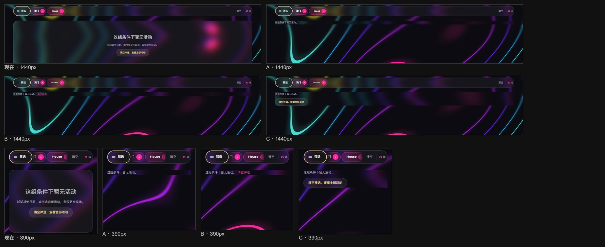
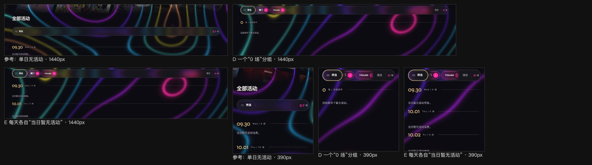
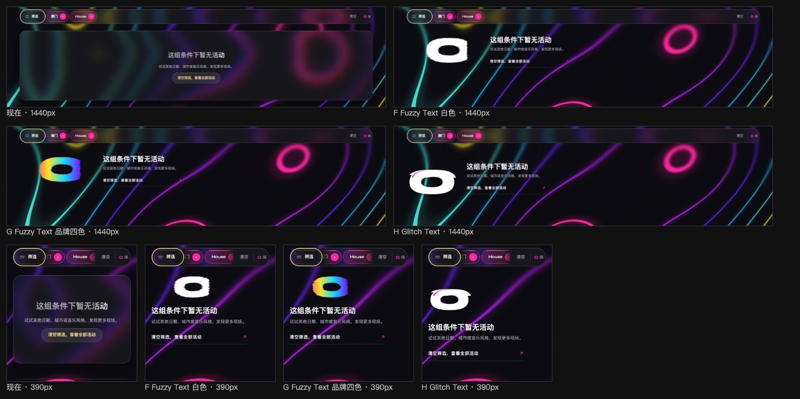
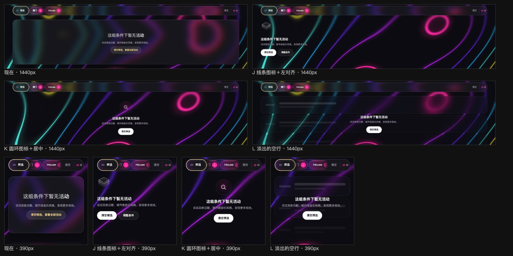
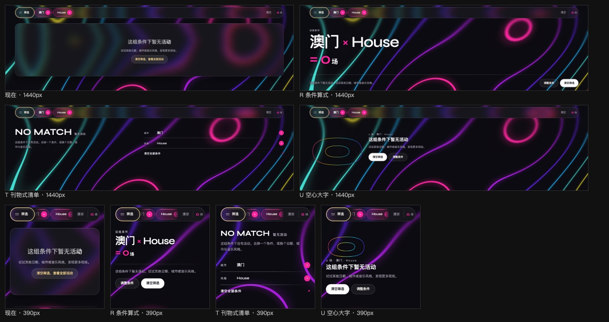
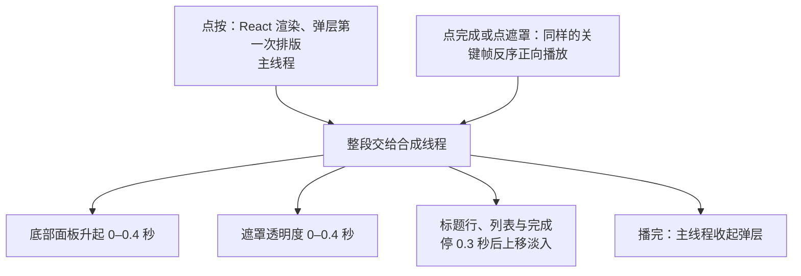
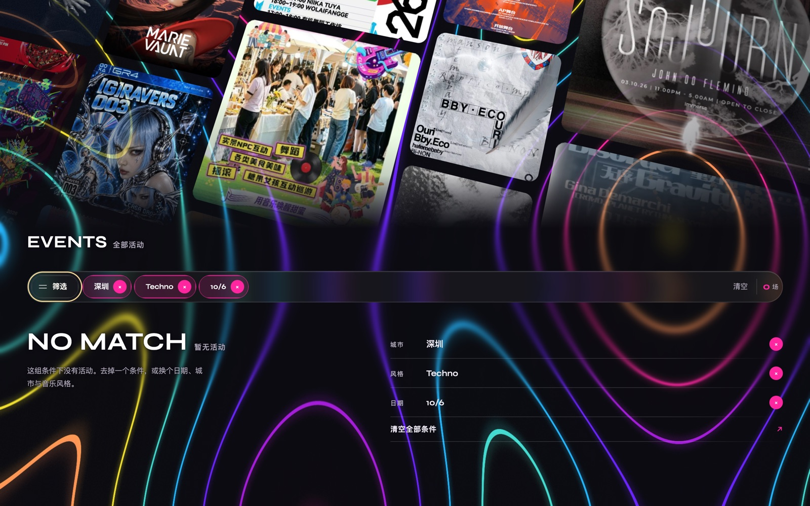
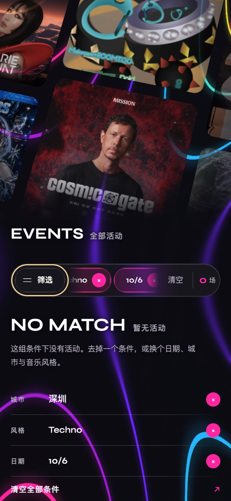
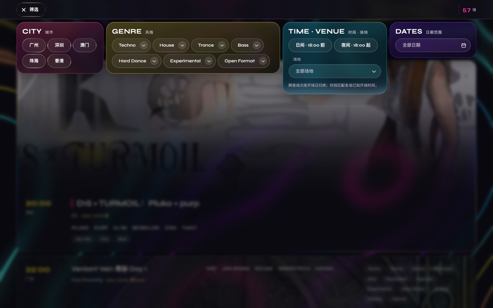
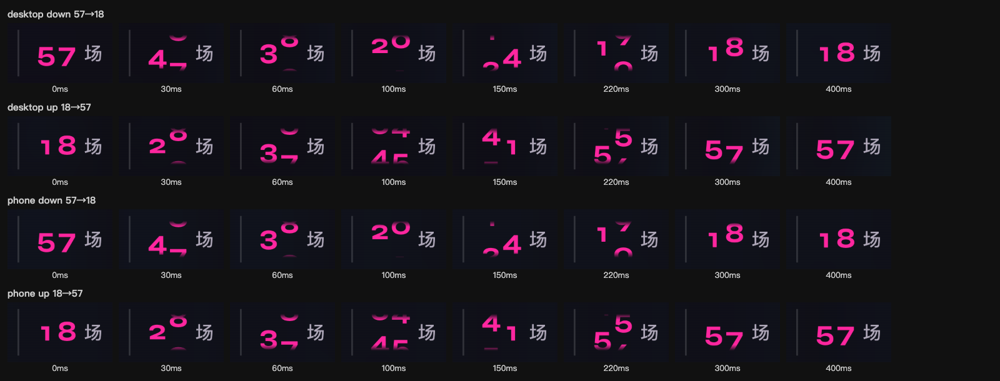

# 活动筛选

## 问答

### 请求：重新设计筛选无结果时的空状态

> 2026-10-10：“这一块的风格ui要对齐单日无活动时的那种”（附图：筛选无结果时的玻璃卡片“这组条件下暂无活动”）

> 2026-10-10：“不对齐了，重新设计空状态，看看reactbits，https://www.designmd.co/catalog”

> 2026-10-10：“去这里找找最好的空状态https://bestdesignsonx.com”

### 已查明事实

| # | 事实 | 来源 |
| --- | --- | --- |
| F28 | 筛选无结果时的空状态是一张 24px 圆角磨砂玻璃卡片（上下 64px 内距）：标题“这组条件下暂无活动”（24px，React Bits Shiny Text 流光）、说明“试试其他日期、城市或音乐风格，发现更多现场。”、金色字的玻璃胶囊“清空筛选，查看全部活动”（AGENTS.md 第五节、第 189 题前后定下） | `src/components/Page.tsx` 的 `EMPTY`、`RESET`；`src/components/ShinyText.tsx`；AGENTS.md |
| F29 | 某天没有活动时，日期标题下只有一行字“当日暂无活动信息。”：13px、灰色（`--muted`）、带直接压在地形上的柔和深色描边，没有卡片、标题或按钮 | `src/components/Page.tsx` 的 `DayGroup`（`empty-day`） |
| F30 | 空状态只在选了条件后出现，这时吸顶工具栏里一定有“清空”按钮，所以空状态里的“清空筛选”与它重复；检查脚本里核对空状态是磨砂玻璃、标题有流光，并点“清空筛选”回到全部活动 | `src/components/FilterDock.tsx`；`test/browser/layout.js`；`scripts/check-browser.ts` |
| F31 | 候选（澳门＋House 筛出 0 场，直接改页面截图）：A 只留一行“这组条件下暂无活动。”，与单日无活动同样大小、颜色与描边；B 同一行后面跟品牌粉文字“清空筛选”；C 一行字下面保留原来的“清空筛选，查看全部活动”胶囊。截图里文字后面的模糊带是地形按原来卡片的位置算的，正式改动后会按新位置重算 | [候选截图](event-filters/empty-candidates.jpg)；草稿目录 `empty/candidates.ts` |
| F32 | 第二轮候选（澳门＋House，直接改页面截图）：真实的单日无活动是日期标题（金色 Syne 大字日期、小字星期与场数、Star Border 分割线）下面一行灰字，地形在标题与这行字后面加了模糊；D 把空状态换成一个同样结构的“0 场”分组；E 把每个日期分组照常列出、每天写“当日暂无活动信息。”。截图里 D、E 的字后面还没有模糊带，正式改动会按日期分组的规则加上 | [第二轮截图](event-filters/empty-round2.jpg)；草稿目录 `empty/round2.ts`；`src/client/topography.ts` 的 `measure`、`textBands` |
| F33 | DesignMD 目录（designmd.co/catalog）是各品牌的 DESIGN.md 设计令牌集，公开部分 12 个（Netflix、Vercel、Perplexity 等，深色与带动效的可筛选），单页只有颜色、字体与间距令牌，没有空状态的样式；同站的 Taste Skill 说明点出 AI 默认做法的问题：居中、安全、像模板的内容块，建议层级分明、必要时不对称、留白有意图、动效克制有目的。现在的空状态正是居中的玻璃卡片 | https://www.designmd.co/catalog ；https://www.designmd.co/d/netflix ；https://www.designmd.co/taste-skill （内置浏览器） |
| F34 | React Bits 里适合空状态的文字效果：Fuzzy Text（原版演示就是“404”：画到画布上，每一行随机左右错开，默认抖动强度 0.18、悬停 0.5、幅度 30px、60 帧，有渐变参数）；Glitch Text（纯 CSS，文字上叠两层切片，左右偏 10px、带红青影，循环剪裁动画）；Decrypted Text（字符乱码后逐个显出，用在中文上效果不明显）。站里已用 Shiny Text | `DavidHDev/react-bits` 的 `FuzzyText.jsx`、`GlitchText.jsx`／`.css`、`DecryptedText.jsx` |
| F35 | React Bits 候选（澳门＋House，直接改页面截图，桌面与手机）：都去掉玻璃卡片、改为左对齐（手机上下排）——左边一个 Syne 大“0”，右边标题、说明与详情区同款的“清空筛选，查看全部活动 ↗”文字链接，文字带地形描边。F 白色 Fuzzy Text、G 品牌四色 Fuzzy Text、H Glitch Text。Fuzzy Text 每帧在画布上重画（只在空状态显示时），Glitch Text 是 CSS 动画；减少动态效果时都可以静止 | [React Bits 候选截图](event-filters/empty-reactbits.jpg)；草稿目录 `empty/proto.js`、`empty/proto.ts` |
| F36 | Best Designs on X 的“Empty States”合集（18 条，看了其中 14 张图）：几乎都是一个小的单色细线插图或图标（层叠的面、文件柜、带圆环的放大镜、发光小球），一句短标题，一两行灰色说明，一个小的主按钮（常配一个次要按钮）；深色的几张把内容左对齐放在留白里（如“Projects”空状态：线条图标、标题、说明、两个胶囊按钮）；也有把淡化的占位内容（头像、列表）铺在后面、文字叠在上面的写法；没有大面积卡片或大号流光标题 | https://bestdesignsonx.com/search/Empty+States/ （内置浏览器） |
| F37 | 第三轮候选（澳门＋House，直接改页面截图，桌面与手机）：J 层叠卡片线条图标＋左对齐的标题、说明与“清空筛选”“调整条件”两个胶囊；K 细边圆环里的放大镜（带一点品牌粉）＋居中的标题、说明与“清空筛选”；L 三条与活动行同款的磨砂玻璃空行逐条变淡，标题、说明与“清空筛选”叠在中间。都沿用站内的 40px 胶囊、Syne 13px 按钮字与地形描边 | [第三轮截图](event-filters/empty-round3.jpg)；草稿目录 `empty/proto2.js`、`empty/proto2.ts` |
| F38 | 第四轮候选（澳门＋House，直接改页面截图，桌面与手机），都不用卡片、左对齐、按站内的 Syne 大字与细线排：R 条件算式（“这组条件”小标签，Syne 600 大字“澳门 × House”与品牌粉“= 0 场”，细线下面一行说明与两个胶囊）；T 刊物式清单（详情区的英文大字＋中文标签写法“NO MATCH 暂无活动”，右栏把每个条件排成一行细线、行尾粉色 ×，末行“清空全部条件 ↗”）；U 空心大字（品牌四色描边的空心 Syne “0”，旁边小字“0 场 · 澳门 · House”、标题、说明与两个胶囊）。R、U 的条件文字取自工具栏的已选标签 | [第四轮截图](event-filters/empty-round4.jpg)；草稿目录 `empty/proto3.js`、`empty/proto3.ts` |
| F39 | 英文大字加中文小标签的标题现在用在活动详情的各区：TIMETABLE／LINEUP 时间表／阵容、TICKETS 票务、DETAILS 活动详情、ENTRY 入场须知、VENUE 地点（英文 Syne 700 20px 白色，中文 11px 灰色，基线对齐）；“全部活动”标题是 30px（手机 26px）的中文半粗体；筛选面板四张卡片的标题是只有中文的 Syne 700 20px（城市、风格、时段 · 场地、日期范围） | `src/components/EventRow.tsx` 的 `DetailSection`、`INFO_SECTIONS`；`src/components/Page.tsx`；`src/components/FilterDock.tsx` 的 `LEGEND` |

### 问答

| # | 问题 | 答复 | 影响 |
| --- | --- | --- | --- |
| Q12 | 无结果时改成哪种（F28–F31，见候选截图）：A 只留一行字——“这组条件下暂无活动。”，和“当日暂无活动信息。”同样大小、颜色与描边，去掉卡片、流光标题、说明与按钮，清空用工具栏的“清空”；B 一行字加文字链接——同一行后面跟品牌粉“清空筛选”；C 一行字加原来的胶囊按钮——字下面保留“清空筛选，查看全部活动”。推荐 A：与单日无活动完全一致，工具栏的“清空”一直在，不重复 | “这个样式不符合整体啊”（2026-10-10 提问工具） | 没有选 A–C；补出像日期分组那样的候选，与真实的单日无活动并排再问（Q13） |
| Q13 | 哪种更符合整体（F29、F32，见第二轮截图，左上是真实的单日无活动）：A 只留一行字“这组条件下暂无活动。”（同第一轮 A）；D 一个“0 场”分组——像日期分组一样，金色大字“0”、小字“场 / 这组条件”与分割线，下面一行“这组条件下暂无活动。”；E 照常列出日期分组——每天的标题写“0 场”，下面各自“当日暂无活动信息。”（没选日期时列出全部 7 天）。推荐 D：与日期分组的标题、分割线和描边文字一致，又只占一组的位置；E 最像单日无活动，但没选日期时是 7 行重复的字。也可以直接说想要的样子 | “还是不符合，整体设计”（2026-10-10 提问工具） | A、D、E 都不合适；先问清“整体设计”指什么（Q14） |
| Q14 | “对齐单日无活动、符合整体设计”具体指什么（F28–F32）：一、两处都改成玻璃卡片——单日无活动也做成与活动行同款的 24px 磨砂玻璃（像一条收起的活动行），筛选无结果用同一种卡片；二、保留现在的玻璃卡片，只把里面换成单日无活动的写法（一行灰字，去掉流光大标题、说明与胶囊）；三、都不是——请描述或截图指出哪里不对 | “不对齐了，重新设计空状态，看看reactbits，https://www.designmd.co/catalog”（2026-10-10 提问工具） | 不再对齐单日无活动，重新设计空状态：参考 React Bits 与 DesignMD 目录出候选（Q15）；Q12、Q13 的候选不再适用 |
| Q15 | 空状态用哪种（F33–F35，见 React Bits 候选截图）：F Fuzzy Text 白色——左边一个按原版默认参数抖动的大“0”，右边（手机在下面）标题“这组条件下暂无活动”、一行说明和详情区同款的文字链接“清空筛选，查看全部活动 ↗”，不用卡片；G 同一布局，“0”用原版的渐变参数填品牌四色；H 同一布局，“0”换成 Glitch Text（原版的切片动画，红青影改成品牌粉、青）。推荐 F：左对齐、不再是居中模板卡片（F33），抖动的“0”有现场感又不抢颜色，品牌色留给结果数与链接箭头 | “都不好看”（2026-10-10 提问工具） | F、G、H 都不用；“大‘0’加左对齐文字”这个方向放弃，先请你从 React Bits 里定方向（Q16） |
| Q16 | 从 React Bits 里选哪个方向做空状态（F34）：Circular Text——一圈文字绕着中心慢转，像一张在转的唱片，中间放“这组条件下暂无活动”（https://reactbits.dev/text-animations/circular-text）；Orb——一团品牌色的发光球体在文字后面缓缓流动（https://reactbits.dev/backgrounds/orb）；Pixel Card 或 Dot Grid——像素格或点阵的卡片，手指或鼠标划过时亮起（https://reactbits.dev/components/pixel-card 、https://reactbits.dev/backgrounds/dot-grid）；也可以写你在 React Bits 上看中的组件名。推荐 Circular Text：转动的唱片与音乐现场贴合，手机上不靠悬停也有动静，选定后照原版移植、给桌面与手机截图 | “去这里找找最好的空状态https://bestdesignsonx.com”（2026-10-10 提问工具） | 不限 React Bits，参考 Best Designs on X 的“Empty States”合集出候选（Q17） |
| Q17 | 空状态用哪种（F36、F37，见第三轮截图）：J 线条图标＋左对齐——一个层叠卡片的细线图标，下面标题、一行说明，按钮“清空筛选”（白底）与“调整条件”（打开筛选面板，玻璃胶囊），不用卡片；K 圆环图标＋居中——细边圆环里一个放大镜（带一点品牌粉），下面标题、说明与“清空筛选”；L 淡出的空行——三条与活动行同款的磨砂玻璃空行逐条变淡，标题、说明与“清空筛选”叠在中间。推荐 L：直接用清单自己的行样式表达“这里本该有活动”，与整页的玻璃与地形最一致；J、K 是合集里最常见的图标式写法 | “还是不行，我要的是设计感，布局，高级感设计”（2026-10-10 提问工具） | J、K、L 都不用；改从版式与字体入手，做刊物感的排版（Q18） |
| Q18 | 空状态用哪种（F38，见第四轮截图）：R 条件算式——小字“这组条件”，大号 Syne 把当前条件写成“澳门 × House”，下一行品牌粉“= 0 场”，细线下面左边一行说明、右边“调整条件”“清空筛选”；T 刊物式清单——照详情区的写法，左边英文大字“NO MATCH”加中文小标签与一段说明，右边每个条件一行细线、行尾可点的粉色 ×，末行“清空全部条件 ↗”；U 空心大字——一个品牌四色描边的空心“0”，旁边一行小字“0 场 · 澳门 · House”、标题、说明与两个按钮。推荐 R：把“这组条件”直接排成主角，大字、留白与细线的刊物感最强，又说明了为什么是 0 场；T 的英文“NO MATCH”是新文案，要你认可 | “T可以，如果这样的话，那么全部活动哪里也要对齐标题，也就是英语加中文，这一套标题用在了很多地方”（2026-10-10 提问工具） | 空状态用 T（英文“NO MATCH”加中文“暂无活动”，条件逐行细线、可逐个移除，末行“清空全部条件 ↗”）；“全部活动”标题也改成英文加中文的同一套写法（Q19–Q21） |
| Q19 | “全部活动”配哪个英文（F39）：A “EVENTS”——单个词，与 TICKETS、VENUE 同类；B “ALL EVENTS”——与中文逐字对应；C “PARTIES”——更贴近派对现场。推荐 A：最短，与详情区那套英文标题的口吻一致 | “A EVENTS”（2026-10-10 提问工具） | 清单标题为“EVENTS 全部活动” |
| Q20 | 这套英文加中文的标题还要用到哪（F39）：A 只改“全部活动”与空状态；B 连筛选面板四张卡片的标题也改（如 CITY 城市、GENRE 风格、TIME · VENUE 时段 · 场地、DATES 日期范围）。推荐 A：先把清单与空状态对齐，卡片标题要不要改等看过效果再定 | “B 筛选卡片也改”（2026-10-10 提问工具） | 筛选面板四张卡片的标题也改成英文加中文：CITY 城市、GENRE 风格、TIME · VENUE 时段 · 场地、DATES 日期范围 |
| Q21 | “全部活动”标题属于活动清单（活动浏览的文档），这次怎么记：A 并进这次的空状态任务，一起改、一起验收，记在筛选文档；B 另作一件，记在活动浏览文档。推荐 A：两处是同一套标题写法，一起看才知道层级对不对 | “A 并进空状态任务”（2026-10-10 提问工具） | 清单标题与卡片标题并进本任务，记在本文档，一起验收 |
| Q22 | 怎么分层（Q18–Q21）：A 一层——空状态改成 T、清单标题改“EVENTS 全部活动”、四张筛选卡片标题改成英文加中文，一起验收；B 两层——L1 空状态 T，L2 清单与卡片标题统一。推荐 A：三处是同一套标题，放在一起才看得出层级；改动都在 `Page.tsx`、`FilterDock.tsx` 与 `EventRow.tsx` 的标题写法上 | “A 一层”（2026-10-10 提问工具） | 一层：空状态、清单标题与卡片标题一起改、一起验收 |

### 以往：筛选面板打开后触屏滚动穿透（2026-10-09）

> 2026-10-09：“触屏下，筛选点开之后滚动好像穿透了”

- 学习：写入：moss-browser（改了只在安全上下文提供的接口后，用局域网 IP 在无头 Chrome 里打开核对；要 moss 在手机上打开的地址写进提问卡片的问题里）

### 已查明事实

| # | 事实 | 来源 |
| --- | --- | --- |
| F1 | iPhone Air 模拟器的 Safari 里（当前构建，即线上 `c91a864`），筛选面板打开后试了 6 种手势：在卡片上慢慢上拖越过面板的尽头、在卡片上往上快甩、往下快甩、在面板底部空白处上拖、在顶部筛选栏上往下拖（慢、快各一次）。页面的滚动位置全程不变（最大变化 0），页面没有一次滚动事件，可视视口也没有移动；卡片滑到尽头时只在面板里回弹 | 模拟器加调试浮层（每帧记下 `scrollY`、可视视口与面板的滚动） |
| F3 | 点“筛选”后，工具栏不在吸顶位置时先平滑滚过去（最多约 1.5 秒），这期间页面还没锁：手指在这时滑动会滚动页面 | `FilterDock.tsx` 的 `dockBar`、`glideTo` |
| F5 | 与本任务无关（重写 L3 引入的问题）：在不是安全上下文的地址上（如手机经局域网 IP 打开的 http 预览），浏览器没有 `DeviceOrientationEvent`，而 `src/lib/glass.ts` 在判断它存在之前就读了它，抛出 “Can't find variable: DeviceOrientationEvent”，整个页面坏掉（活动行为 0）；线上是 HTTPS、模拟器的 127.0.0.1 也算安全上下文，所以都没出现。诊断页暂由代理补一个空的构造函数绕过，项目代码没改（已由提交 `cac6709` 修好） | moss 的 iPhone 报错；无头 Chrome 经局域网地址打开时活动行为 0 |
| F6 | moss 在 iPhone 的 Safari 里打开诊断页（当前构建加调试浮层，经局域网或 Tailscale 的 http 地址），点“筛选”后在卡片上滑到头再继续滑：这次没复现。诊断页与线上的差别：它是 http，没有第一次点按时的“动作与方向”授权提示（F4），也没有随手机晃动的光效 | moss 的 iPhone（2026-10-09） |

### 问答

| # | 问题 | 答复 | 影响 |
| --- | --- | --- | --- |
| Q1 | 在哪台设备、哪个浏览器上看到的（F1：模拟器的 Safari 里复现不了）：iPhone 的 Safari、iPhone 的微信、安卓手机（写明浏览器），或别的；是线上站点还是预览地址 | “iPhone Safari”（2026-10-09 提问工具） | 在 iPhone 的 Safari 里复现与验证 |
| Q2 | 当时怎么滑、看到什么在动（F1–F3）：A 在卡片上滑，滑到头后下面的活动清单跟着动；B 点开后马上滑，面板还在展开或页面还在滚向吸顶位置时；C 在卡片之间的空隙、底部空白或顶部筛选栏上滑；D 关掉筛选后，页面停在了和打开前不同的位置；或别的情形（写明） | “A 卡片滑到头”（2026-10-09 提问工具） | 要查的是：在卡片上滑到面板尽头之后，后面的清单为什么会动 |
| Q3 | 在线上站点（https://events.cardioravers.com/ ，HTTPS）照 A 那样滑，还能复现吗（F6：http 的诊断页上复现不了）：A 线上还能复现——差别多半在只有 HTTPS 才有的授权提示或晃动光效，下一步做一个 HTTPS 的诊断页（如带调试浮层的 Vercel 预览）在线上条件下量；B 线上也复现不了——按复现不了处理，记下现象，以后再出现时再查 | “线上也复现不了”（2026-10-09 提问工具） | 不改代码，结论写明现象、排查与再出现时的量法 |

### 以往：底部弹层卡顿、点击穿透与标签条滚动（2026-10-09）

> 2026-10-09：“还有一点，bottomsheet弹出弹入动画很卡，然后bottomsheet显示时也有点击穿透问题。
> 然后筛选栏里的标签在触屏上好像能上下滚动，然后标签上下边框似乎也被裁切了一部分。”

### 已查明事实

| # | 事实 | 来源 |
| --- | --- | --- |
| F2 | 锁滚动的做法：工具栏滚到吸顶位置之后，才给 `<html>` 加 `is-filtering`（`overflow: hidden`、`scrollbar-gutter: stable`）并显示面板；面板 `overflow-y: auto`、`overscroll-behavior: contain`，高度到屏幕底边，遮罩是全屏的固定层。重写前（`9878269` 的 `assets/filters.js`、`site.css`）是同一个做法 | `src/components/FilterDock.tsx` 的 `setOpen`、`fitPanel`；`src/styles/app.css` |
| F4 | 触屏上第一次点按会弹出“动作与方向”授权（镜面光随手机晃动要用，`src/lib/glass.ts` 在第一次点按时请求）；模拟器里有一次，第一次点“筛选”只弹出了授权、面板没打开，再点一次才打开 | 模拟器 |
| F7 | 标签条 `ul.filter-tags` 横向可滚（`overflow-x: auto`），按 CSS 规则纵向也跟着成了 `auto`。标签与标签条都是 40px 高，每个标签的反光环（`specular-rim` 的 `::after`，向外 0.7px、环宽 1.4px）比标签多出 0.7px：标签条内容高 41px、框高 40px，纵向能滚 1px（无头 Chrome 量得 `scrollHeight` 41、`clientHeight` 40，`scrollTop` 能设到 1）。反光环上下向外的那一半被标签条的滚动框裁掉，外层的渐隐遮罩 `.filter-tags-edge`（也是 40px 高，遮罩只画到自身边框以内）同样裁掉它；第一个标签左侧的反光环也一样被裁 | `src/components/FilterDock.tsx` 356–358 行；`src/styles/app.css` 的 `specular-rim`、`fade-edges`；无头 Chrome 390×844 实测 |
| F8 | iPhone Air 模拟器的 Safari：按住筛选栏里的标签往下拖，标签跟着手指往下走、被标签条下沿裁掉一截，松手弹回——iOS 对只溢出 1px 的滚动框照样给回弹（F7） | 模拟器拖动中的截图 |
| F9 | 手机宽度（768px 及以下）的场地、风格小类与日期弹层是底部面板：`popover="manual"` 的顶层弹层，暗色遮罩是弹层的 `::backdrop`。浏览器自带样式给打开的弹层的 `::backdrop` 写死了 `pointer-events: none !important`，页面改不了：点在遮罩上的手指落到下面的元素。弹层在“按下的位置不在它里面”时关闭，这一下却照样传给下面——Chrome 里点遮罩上“广州”的位置，弹层关闭、广州被取消（标签 2 个变 1 个）；模拟器 Safari 里点遮罩上“深圳”的位置，弹层关闭、深圳被选上（标签栏出现“深圳”，结果变 18 场）。筛选面板自己不理这一下（有弹层开着时不关面板），所以只有遮罩下面的胶囊与按钮会被点到；在遮罩上拖动也会落到下面的面板上。宽屏的下拉没有遮罩，点外面关闭的同时点到目标，是普通下拉的做法，这次没报告 | `src/components/Pickers.tsx` 的 `PickerPop`（`press`）；`src/components/FilterDock.tsx` 的 `press`；WebKit 自带样式 `Source/WebCore/css/popover.css`；无头 Chrome 与模拟器实测 |
| F10 | 弹层的动画：打开时底部面板从屏幕下沿升起（`transform`），遮罩淡入（自定义属性 `--veil` 驱动 `::backdrop` 的透明度），0.3 秒起标题行、列表与“完成”依次上移 50px 淡入，间隔 0.08 秒；关闭倒放。都用 `EASE`——把 GSAP power3.out 写成 31 个点的 CSS `linear()`；下拉松手后的回弹用 `cubic-bezier` | `src/components/Pickers.tsx` 的 `play`、`release`；`src/lib/motion.ts` |
| F11 | 已发布的 Safari 不把缓动是 `linear()`（带点列）的动画交给合成线程，只在主线程逐帧算：WebKit 源码的 `KeyframeEffect::canBeAccelerated()` 在 Core Animation 这条路上遇到 `linear()` 或 `steps()` 就返回否；WebKit bug 312407（2026-04，iOS 与桌面 Safari 26 上只动 `transform`、`opacity` 也掉帧）记的正是这件事，新的“按时间线程化的动画”开关在 Safari 技术预览版里默认开、修好了它，没有正式版的时间。自定义属性的动画（如 `--veil`）在任何浏览器里都在主线程。带延迟的动画要等延迟结束、主线程跑到那一帧才交给合成线程（`updateAcceleratedActions`） | WebKit 源码 `Source/WebCore/animation/KeyframeEffect.cpp`；https://bugs.webkit.org/show_bug.cgi?id=312407 |
| F12 | 模拟器（iOS 27.0 Safari）对照：点开场地弹层、等两帧后让主线程忙 3 秒。现在的写法，底部面板停在升到三分之一处、遮罩不出现，主线程空出来才一下跳到终点；把缓动换成 `cubic-bezier`，或把同一条曲线写成 31 个关键帧、帧间用普通 `linear`，底部面板在主线程忙的时候照样升到顶；只去掉底部面板的背景模糊或遮罩动画都没有这个效果；遮罩（自定义属性）在各种写法下都停住。关闭（倒放、带延迟）在只等两帧的条件下各种写法都停住，原因（倒放、延迟还是图层还没建好）还没分清 | 模拟器截图 |
| F13 | 模拟器（每秒 60 帧）逐帧计时：场地弹层打开大多满帧，偶有一帧 36–148ms（多在前 0.3 秒）；风格小类、日期弹层与各弹层的关闭很少超过 34ms。分别关掉遮罩动画、底部面板的模糊、遮罩的模糊、地形或内容上移，各 12 次开关里没有一致的差别：模拟器用 Mac 的 CPU 与显卡，主线程很少忙到卡住动画，测不出手机上的手感 | 模拟器测速（场地弹层 6 组各 12 次，全部弹层 6 组各 12 次） |
| F14 | Chrome（手机 390×844、CPU 降速 4 倍）逐帧记录：弹层打开与关闭期间主线程每帧 10–14ms（地形的一帧 4–6ms；遮罩的自定义属性被弹层里每个元素继承，每帧重算样式 3–7ms），弹层停稳后每帧 2–4ms；点按那一下 46–59ms（React 重渲染整页，加上弹层第一次排版约 15ms——这次排版第一帧本来就要做），弹层报告打开后再重渲染一次 13ms。Safari 每秒 60 帧时一帧有 16.7ms，微信 120 帧时只有 8.3ms | Chrome 性能跟踪 |
| F15 | 同一条 `linear()` 缓动（`EASE` 与样式里的 `--ease-card`）还用在：筛选面板的遮罩淡入与卡片上移（面板的高度增长是排版动画，换什么缓动都在主线程）、已选条件标签的出现与让位、活动详情各区的上移与摘要淡入、清单里当天第一条的色条与标题、清单行海报的灰度与位移过渡 | `src/components/FilterDock.tsx`、`EventDetail.tsx`、`EventRow.tsx`；`src/styles/app.css` |
| F16 | 关闭用倒放（`direction: 'reverse'`）写的动画，即使曲线已写成关键帧，Safari 也不交给合成线程：点“完成”后 12 帧让主线程忙 3 秒，标题行、搜索框、列表与“完成”一直完整显示；同一个动作写成正向播放（关键帧按相反顺序排、方向不变）时，它们在主线程忙的时候照样淡出。底部面板自己的退场要等 0.46 秒（等里面的内容先走）才开始，在两种写法下都停着——带延迟的动画要等延迟结束、主线程跑到那一帧才交出去（F11）；把延迟写成关键帧开头停住不动的一段，动画从点按起就是一整段，不必等主线程 | 模拟器截图 |
| F17 | 弹层收起要 0.86 秒（内容先走，底部面板随后），这期间弹层还开着：自己的遮罩若照样接点按，紧接着的点按会被挡住（模拟器里点“完成”后马上点“深圳”没选上）；原来的 `::backdrop` 不接点按，收起途中的点按会落到页面上 | 模拟器；`scripts/check-browser.ts` |

### 问答

| # | 问题 | 答复 | 影响 |
| --- | --- | --- | --- |
| Q4 | 这次改哪些动画的写法（F11、F12、F15）：A 只改底部弹层（报告的问题）；B 筛选这一块全改——底部弹层、筛选面板的遮罩与卡片、已选条件标签（面板的高度增长仍在主线程）；C 在 B 之外再改活动详情与清单行（跨到活动浏览模块，另提一个请求更清楚）。三种都保持曲线、时长与样子不变，只是改成 Safari 能交给合成线程的写法。推荐 B：原因相同、都在筛选里，标签的出现与让位正好发生在改了条件、清单重新渲染、主线程最忙的时候 | “B 筛选这一块”（2026-10-09 提问工具） | 底部弹层、筛选面板的遮罩与卡片、已选条件标签的动画都改成 Safari 能交给合成线程的写法，曲线、时长与样子不变；面板的高度增长照旧；活动详情与清单行不在这次范围 |
| Q5 | 卡顿怎样算修好（F12、F13）：A 我在模拟器里证明动画已交给合成线程（主线程忙时底部面板与遮罩照样动完）、逐帧计时不变差，验收时再请你在看到卡顿的那台手机、那个浏览器里实际看；B 在 A 之外，做一个手机测试页，让你盲比改前改后两种写法（顺序打乱、不标名字）。推荐 A：模拟器测不出手机的手感（F13），但能直接证明卡顿的原因已经去掉（F12），手感由你验收时判断 | “A 模拟器证明加手机上看”（2026-10-09 提问工具） | 验证：模拟器里主线程忙时动画照样走完、逐帧计时不变差；验收时 moss 在看到卡顿的手机与浏览器里看 |
| Q6 | 怎么分层（Q4、Q5 已定）：A 三层——L1 标签条（`src/components/FilterDock.tsx`：标签条纵向不能滚，四周留 1px 给反光环、外边距 -1px 让标签位置不变；`test/browser/layout.js` 加断言：标签条不能纵向滚、反光环在标签条与渐隐遮罩以内；解决 F7、F8）；L2 点击穿透（`src/components/Pickers.tsx`：手机上弹层铺满屏幕，底部面板以外是一层真正的遮罩，取代 `::backdrop`、样子不变，点它只关弹层，在它上面拖不会动到后面的面板，下拉关闭与松手回弹改为调这层遮罩的透明度；`scripts/check-browser.ts` 加检查：点遮罩后弹层关闭、筛选条件不变；解决 F9）；L3 动画交给合成线程（`src/lib/motion.ts`：把 `EASE` 曲线写成关键帧，延迟写成开头停住的一段，关闭写成反序的正向播放；`Pickers.tsx` 的底部面板、遮罩与内容，`FilterDock.tsx` 的面板遮罩、卡片与标签改用它，曲线、时长与样子不变；解决 F10–F12、F16）。B 两层——L1 是 A 的 L1 加 L2（标签条与点击穿透），L2 是 A 的 L3（动画）。C 一层，全部一起做。推荐 B：两处小修都靠 Chrome 与模拟器的点按、拖动核对，一起验收即可；动画要你在手机上看手感（Q5），单独一层，看的时候不夹杂别的改动 | “B 两层”（2026-10-09 提问工具） | 方案按两层写：L1 标签条与点击穿透，L2 动画交给合成线程 |

### 以往：结果数变化时滚动（2026-10-10）

> 2026-10-10：“筛选栏右边的数字变化时加一点滚动动画”

### 已查明事实

| # | 事实 | 来源 |
| --- | --- | --- |
| F18 | 筛选栏右端的结果数是 `<strong id="result-count">`（Syne 700 17px、品牌粉），后面跟灰色小字“场”；外层 `
` 是 `role="status"`、`aria-live="polite"`，读屏读的是旁边隐藏的“全部 57 场活动”这类说明。数字在任何条件变化时跟着变（勾选、移除标签、“清空”），范围 0–57，一位或两位数；现在是直接换字，没有动画 | `src/components/FilterDock.tsx`；`src/components/Page.tsx`（`count={valid ? total : events.length}`） |
| F19 | React Bits 的 Counter 组件：每一位是一列竖排的 0–9，数字变化时整列上下滚到新数字（走较短的方向，中间的数字会滚过去）；用 motion 库的弹簧（默认刚度 100、阻尼 10、质量 1，阻尼比 0.5，会冲过头再回弹，约 1 秒停稳）；上下各 16px 渐隐遮住列里别的数字；位数变化（如 57→8）时多出的那一列直接消失 | https://github.com/DavidHDev/react-bits `src/content/Components/Counter/Counter.jsx` |
| F20 | 站内没有 motion 等动画库，弹层与标签的动效都是自写的 Web Animations：Card Nav 节奏 0.4s power3.out，走 `eased()` 让 Safari 交给合成线程；标签增减不过冲（新标签自 0.8 缩放淡入）；减少动态效果时一律不动 | `package.json`；`src/lib/motion.ts`；AGENTS.md 第五节；项目技能 `pages-site-visual-choices` |
| F21 | 实现后的核对：无头 Chrome（GPU）停帧——57→18 与 18→57 在 0、30、60、100、150、220、300、400 毫秒，桌面与手机宽度，起止数字正好居中、中间各位滚过、上下渐隐，[停帧图](event-filters/count-frames.png)；iPhone Air 模拟器 Safari：勾选深圳后让主线程空转 3 秒，空转开始 1.2 秒时的截图结果数已停在 18（数字带还没被脚本收起），滚动由合成线程跑完 | 草稿目录 `count/frames.ts`、`sheet/count.js`；`xcrun simctl io` 截图 |

### 问答

| # | 问题 | 答复 | 影响 |
| --- | --- | --- | --- |
| Q7 | 数字怎么滚（F18–F20）：A React Bits Counter——每一位像里程表一样上下滚到新数字，中间的数字会滚过去，上下渐隐；B 整个数字一起滑——旧数字向上滑出、新数字从下面滑进来（变少时反过来），不经过中间数字；C 计数——数字从旧值一个个数到新值，不滚动。推荐 A：最像“滚动”，也是 React Bits 原版做法；动得快慢与回弹要不要照原版另问 | “A 里程表式”（2026-10-10 提问工具） | 照 React Bits Counter：每一位一列 0–9 上下滚到新数字，上下渐隐；快慢与回弹见 Q8 |
| Q8 | 滚动的快慢与回弹（Q7、F19、F20）：A 照原版弹簧——冲过头再回弹，约 1 秒停稳，更有弹性；B 筛选其余动效的节奏——0.4s power3.out，干脆停住、不过冲，和标签、弹层一致。推荐 B：整站动效克制，筛选栏里标签与弹层都不过冲，结果数和它们同时变，节奏一致更整齐 | “B 站内节奏”（2026-10-10 提问工具） | 每一位按 0.4s power3.out 滚到新数字、不过冲；用 `eased()` 写成关键帧，Safari 交给合成线程 |
| Q9 | 怎么分层（Q7、Q8）：A 一层——`src/components/FilterDock.tsx` 的结果数换成逐位滚动的数字（每一位一条从旧值到新值的数字带，用 `src/lib/motion.ts` 的 `eased()` 0.4s 滚到位、上下渐隐；停住时只剩当前数字，读屏照旧读旁边的说明；首次显示与减少动态效果时不动），`scripts/check-browser.ts` 加滚动的检查，AGENTS.md 第五节与本文档结论区写上这条，一次验收；B 两层——L1 先在页面上临时做出效果给你看，L2 再定稿、补检查与说明。推荐 A：样式与节奏都已定，直接做好再看更省事 | “A 一层”（2026-10-10 提问工具） | 一层：做好滚动并补检查与说明，一次验收 |

### 以往：风格小类里排第一的是大类本身（2026-10-10）

> 2026-10-10：“风格里，为什么第一个选项都是大类本身，是不是有问题”

- 学习：无合格候选：本次是对现有数据与排序的解释，没有新的纠正或可复用的做法

### 以往：小类里拿掉与大类同名的一行（2026-10-10）

> 2026-10-10：“C 从小类拿掉”（回答“小类里与大类同名的那一行要不要改？”，见结论区“风格小类里排第一的是大类本身”）

### 已查明事实

| # | 事实 | 来源 |
| --- | --- | --- |
| F22 | 每个风格大类的小类弹层，列的是 `genre_families` 里这一类的全部成员，按本期场数从多到少排（AGENTS.md：只列小类、不设“全部”行）；七个大类都把大类名本身也列为成员（如 Techno 类里有“Techno”），因为有的活动只标了大类名、没有更细的小类 | `src/lib/guide.server.ts`（`members … sort((a, b) => count(b) - count(a))`）；`data/events.json` 的 `genre_families` |
| F23 | 同名成员的场数在五类里最多，所以排第一：Techno 11 场（其中 9 场没有更细的 Techno 小类）、House 9（9）、Bass 9（3）、Trance 5（4）、Experimental 3（2）；Hard Dance 里 Hardstyle 3 场排第一、Hard Dance 1 场，Open Format 里 Hip-Hop 5 场排第一、Open Format 2 场 | `data/events.json` 统计 |
| F24 | 筛选结果是对的：点大类胶囊（“全部 Techno”）筛出这一类全部 22 场；在弹层里只勾“Techno”这一行，只筛出标了 Techno 的 11 场，不含只标 Hard Techno 等小类的场次。容易误会的是这一行与大类同名，看起来像“全部 Techno” | `src/lib/filters.ts`；`src/components/Page.tsx` |
| F25 | 小类弹层的选择规则（第 176、179 题）：点大类胶囊选“全部 X”；整类选中时弹层显示全部小类已勾选，取消其中一项变成其余小类的部分选择；逐个勾满全部小类则回到整类。勾“小类”筛的是标了这个小类的场次，整类筛的是这一类任一成员的场次（含只标大类名的） | `src/components/Page.tsx` 的 `toggleMember`；`src/lib/filters.ts` |
| F26 | 拿掉同名行后各类剩下的小类：Techno 7 个、House 9、Trance 4、Bass 12、Hard Dance 只剩 Hardstyle 1 个、Experimental 4、Open Format 18；只标大类名、没有本类其他小类的场次：Techno 9、House 9、Trance 4、Bass 3、Experimental 2、Open Format 1、Hard Dance 0（这些场次只能靠大类胶囊选到） | `data/events.json` 统计 |
| F27 | 用到成员列表的检查：`test/browser/layout.js` 核对弹层行数等于胶囊的 `data-members`；`scripts/check-browser.ts` 在 Techno 弹层里勾第一行、再勾满其余行来验证“勾满回到整类”；页面上没有保存筛选条件（不读地址或本地存储），不涉及旧状态 | `test/browser/layout.js`；`scripts/check-browser.ts`；`grep localStorage src` |

### 问答

| # | 问题 | 答复 | 影响 |
| --- | --- | --- | --- |
| Q10 | 拿掉同名行后，勾满弹层里的小类算什么（F25、F26）：A 勾满就是整类——照现在“逐个勾满回到整类”，筛出这一类全部场次，也包括只标大类名的（如 Techno 勾满 7 个小类得到全部 22 场，比勾的 13 场多出只标 Techno 的 9 场）；整类时取消一项，剩下的小类不再包括只标大类名的场次；Hard Dance 只剩 Hardstyle 一个小类，勾它就等于整类。B 勾满仍是部分选择——只有点大类胶囊才是整类，弹层勾满显示“7 项”、筛 13 场；整类时打开弹层仍全部勾选，取消一项变成其余小类。推荐 A：保留已定的“勾满回到整类”（第 176、179 题），胶囊的“全部”与弹层的勾选始终一致；只标大类名的场次本来就属于这一类 | “A 勾满即整类”（2026-10-10 提问工具） | 弹层只列与大类不同名的小类；勾满它们回到整类（含只标大类名的场次），整类时取消一项变成其余小类 |
| Q11 | 怎么分层（Q10）：A 一层——`src/lib/guide.server.ts` 给每个大类算出不含同名成员的小类列表，`src/components/Page.tsx` 的小类弹层与“勾满回到整类”改用它，`src/components/FilterDock.tsx` 胶囊上的小类数与没有小类时隐藏箭头跟着改；`test/browser/layout.js`、`scripts/check-browser.ts` 按新列表核对，`test/page.test.tsx` 补“弹层不列同名行”；AGENTS.md 第五节写明，一次验收；B 两层——L1 只改弹层不列同名行，L2 再改检查与说明。推荐 A：改动集中、规则不变，合在一起才能验收 | “A 一层”（2026-10-10 提问工具） | 一层：弹层、规则、检查与说明一起改，一次验收 |

## 结论

### 标题与空状态

- 标题写法（Q18–Q21）：全站的区块标题统一为英文大字（Syne 700，白色）加中文小标签（灰色，基线对齐），英文在前、加 `lang="en"`：清单“EVENTS 全部活动”（英文 30px、手机 26px），筛选卡片“CITY 城市”“GENRE 风格”“TIME · VENUE 时段 · 场地”“DATES 日期范围”（英文 20px），活动详情各区照旧（TICKETS 票务等，20px），空状态“NO MATCH 暂无活动”。
- 空状态（Q18，第四轮 T）：不用卡片，直接压在地形上（文字描边），宽屏两栏、手机一栏：左栏“NO MATCH 暂无活动”（英文 44px、手机 30px）与一段说明“这组条件下没有活动。去掉一个条件，或换个日期、城市与音乐风格。”；右栏是详情区同款的刊物式清单——每个已选条件一行（灰色小字类别“城市／风格／时段／场地／日期”＋条件名），行尾是 24px 品牌粉圆形 ×，点按移除这一个条件，行与行之间是渐隐细线；末行“清空全部条件 ↗”（详情链接同款），点按清空。条件与工具栏的已选标签一致；去掉 Shiny Text 流光标题。

### 风格小类

- 来由（F22–F24）：有的活动只标了大类名（如“Techno”），大类名因此也是这一类的成员；按场数排序时它总排第一，看起来像“全部 X”，与大类胶囊重复、容易误选。
- 小类弹层只列与大类不同名的小类，按本期场数从多到少（Q10）；只标大类名的场次通过大类胶囊“全部 X”选到。
- 选择规则不变（第 176、179 题）：整类选中时弹层显示全部小类已勾选，取消一项变成其余小类的部分选择（不再包括只标大类名的场次）；逐个勾满全部小类回到整类（含只标大类名的场次，Q10）。
- 大类没有别的小类时，胶囊上不显示打开弹层的箭头。

### 底部弹层、遮罩与标签条

- 标签条：`ul.filter-tags` 只横向滚动、纵向不滚，四周留 1px 让每个标签的反光环完整显示，外层的渐隐遮罩随之包住反光环；标签的位置与工具栏的高度不变。
- 底部弹层（768px 及以下）：弹层铺满屏幕，底部面板贴着屏幕下沿，其余部分是弹层自己的一层遮罩（暗色 55% 加 4px 背景模糊，与原来的 `::backdrop` 一样）。点遮罩只关弹层，手指不会落到下面的筛选项；在遮罩上拖动也动不到后面的面板。收起一开始遮罩就放行点按，紧接着的点按照常落到页面上（F17）。宽屏的下拉不变（没有遮罩，点外面关闭）。
- 动画写法：筛选里的底部弹层（面板、遮罩与里面的内容）、筛选面板的遮罩与卡片、已选条件标签的出现与让位，都用 `src/lib/motion.ts` 里按 Card Nav 曲线写好的关键帧（帧间普通 `linear`）：延迟写成开头停住的一段，关闭写成关键帧反序的正向播放。Safari 能把这样的动画整段交给合成线程，主线程忙的时候也照样走完；曲线、时长与样子与原来一样。面板高度的增长与宽屏下拉的擦开是排版与裁切动画，仍在主线程。

图示说明：点开一个底部弹层时，哪些工作在主线程、哪些整段交给合成线程。

### 结果数

- 样式（Q7）：照 React Bits Counter，结果数逐位滚动：每一位像里程表一样从旧数字滚到新数字，个位走过两数之间的每一个数，十位走过十位上的每一个数；数字窗口上下渐隐，滚过的数字从渐隐里出入。位数变多时新的一位直接出现、变少时多出的一位直接消失（同原版）。
- 节奏（Q8）：0.4s power3.out，不过冲；用 `src/lib/motion.ts` 的 `eased()` 写成关键帧，Safari 交给合成线程。滚动途中数字又变时，从当前位置接着滚到最新的数字。
- 停住时每一位只剩当前数字，`#result-count` 的文字就是这个数；读屏照旧只读旁边隐藏的说明（如“全部 57 场活动”），滚动的数字带不给读屏。
- 首次显示与减少动态效果时直接显示新数字，不滚动。

### 触屏滚动穿透（复现不了）

- 现象：moss 在 iPhone 的 Safari 里打开筛选，在卡片上滑到面板尽头后，后面的活动清单跟着动（Q1、Q2）。
- 排查：iPhone Air 模拟器的 Safari 里六种手势都没让页面或后面的清单动（F1）；moss 在 iPhone 上用带调试浮层的诊断页（F6）与线上站点（Q3）都没再复现。锁滚动的做法与重写前相同（F2）。
- 结论：现在复现不了，不改代码。点开后、工具栏还在滚向吸顶位置的那一刻页面还没锁（F3），若以后在这个时机滑动，页面会动，这是已知的行为，不是这次看到的情形。
- 再出现时：经一个本机代理给页面注入每帧记录的浮层（页面滚动位置与滚动事件、后面清单的屏幕位置、窗口与可视视口的高度、面板的滚动），在出问题的设备上复现后读数，分清是页面真的滚了、只是视觉上在动，还是 Safari 地址栏在伸缩；线上才出现时要在 HTTPS 下量（只有 HTTPS 才有动作与方向的授权提示和晃动光效，F4、F6）。
- 另：手机经局域网 http 地址打开时页面会坏掉（F5），已由提交 `cac6709` 修好。

## 记录

### 以往：重新设计筛选无结果时的空状态（2026-10-10）

- 确认：“确认”（2026-10-10 提问工具）
- 学习：L1 已写入 pages-site-visual-choices；验收没有新的反馈，没有别的合格候选

#### 目标与范围

- 目标：筛选无结果时改成刊物式的“NO MATCH 暂无活动”（Q18 的 T），清单与筛选卡片的标题统一成英文加中文（Q19–Q21）。
- 不做：不改活动详情各区已有的标题；不改筛选的匹配逻辑与工具栏；不加新依赖。
- 须遵守：Q18–Q22；AGENTS.md 第五节的控件令牌（×小圆 24px、链接 44px 点按高度）、“内容即操作”与无脚本可用；本站技能 `pages-site-visual-choices`。

#### 层

1. L1 刊物式空状态与英文加中文标题
  - 内容：新增 `src/components/SectionTitle.tsx`（英文大字＋中文小标签，供清单、筛选卡片、空状态与详情各区共用，详情区的 `DetailSection` 改用它）；`src/components/Page.tsx`：清单标题改为“EVENTS 全部活动”，空状态改成两栏刊物式（标题、说明、每个已选条件一行可移除、“清空全部条件 ↗”），去掉 `ShinyText`；`src/components/FilterDock.tsx`：四张卡片的 `legend` 改成 CITY 城市、GENRE 风格、TIME · VENUE 时段 · 场地、DATES 日期范围；删去不再用的 `src/components/ShinyText.tsx` 与 `src/styles/app.css` 里的 Shiny Text 样式；`test/browser/layout.js`：空状态不再是玻璃、不再有流光，核对条件行与工具栏标签一致；`scripts/check-browser.ts`：在空状态里点一行的 × 只移除那个条件，“清空全部条件”回到全部活动；AGENTS.md 第五节的空状态与标题写法改写
  - 验收：筛选无结果时显示“NO MATCH 暂无活动”、说明与逐行条件，点 × 移除那一个、点“清空全部条件”回到全部；清单标题“EVENTS 全部活动”，四张卡片标题英文加中文；桌面与手机截图给你看
  - 验证：`bun run build`、`bun run check:browser`（含新检查）、`bunx tsc --noEmit`、`git diff --check`；无头 Chrome 1440、390 宽截图（空状态、清单标题、打开的筛选面板）
  - 依据：Q18–Q22、F28、F30、F36–F39

#### 交付

- 操作：无（改动留在工作区）

#### 残余风险

- “NO MATCH”比上面的“EVENTS”字更大（照第四轮 T 的样子），两者的大小关系看过截图后可能要调。

### L1 刊物式空状态与英文加中文标题（已完成）

- 改动：新增 `src/components/SectionTitle.tsx`（英文 Syne 700 白色大字＋中文灰色小标签，基线对齐，英文带 `lang="en"`），活动详情各区（`DetailSection`）、清单标题“EVENTS 全部活动”（英文 30px、手机 26px）与筛选卡片的四个标题（CITY 城市、GENRE 风格、TIME · VENUE 时段 · 场地、DATES 日期范围，英文 20px）都用它；`src/components/Page.tsx` 的空状态改成两栏刊物式（不用卡片、文字描边）：左栏“NO MATCH 暂无活动”（英文 44px、手机 30px）与说明，右栏每个已选条件一行（类别＋条件名，整行是按钮，点按只移除这一个条件，行尾 24px 品牌粉 ×），末行“清空全部条件 ↗”沿用详情链接的样式；删去 `src/components/ShinyText.tsx` 与 `src/styles/app.css` 里的 Shiny Text，`src/lib/glass.ts` 不再给空状态加玻璃与折射；`test/browser/layout.js`、`scripts/check-browser.ts` 与 AGENTS.md 第五节同步改写。
- 验证：
  - `bun run build`（20 项测试）、`bun run check:browser`（四个宽度、筛选、点遮罩、活动详情、原图预览、地图菜单）、`bunx tsc --noEmit`、`git diff --check` 都通过。
  - 新检查：空状态不是玻璃、条件行与工具栏标签逐个一致、每行至少 44px 高；在空状态里点日期那一行，只剩 Techno 一个条件、结果回来；再选回无结果，点“清空全部条件”回到全部 57 场。
  - 无头 Chrome（GPU）1440 与 390 宽截图：清单标题、打开的筛选面板、空状态（深圳＋Techno＋10/6）。第一版截图里条件行带着浏览器默认的灰色按钮底，已去掉。

- 学习：写入：pages-site-visual-choices（区块标题统一英文加中文；要“设计感、高级感”时先从排版与布局、真实内容出发，空状态四轮的取舍）
- 验收：“接受并提交”

### 以往：底部弹层卡顿、点击穿透与标签条滚动（2026-10-09）

- 确认：“确认”
- 学习：无合格候选：本任务的规则与约定已在 L1、L2 写入技能，最后一次验收没有新的反馈，代理记忆里没有相关条目

#### 目标与范围

- 目标：标签条在触屏上不能上下滚、反光环不被裁（F7、F8）；点底部弹层的遮罩只关弹层（F9）；底部弹层、筛选面板的遮罩与卡片、已选条件标签的动画在 Safari 里交给合成线程，主线程忙时不卡（F10–F16、Q4）。
- 不做：活动详情与清单行的动画（Q4 没选 C，另提）；面板高度的增长与宽屏下拉的擦开（排版与裁切动画，在主线程）；宽屏下拉点外面时的行为；标签的键盘焦点框（向外 7px）仍会被标签条裁掉，这次报告的是触屏下的反光环。
- 须遵守：Q4、Q5、Q6；曲线、时长与样子都不变，不拿效果换流畅（项目技能 pages-site-visual-choices）；弹层与面板照旧是 Card Nav 节奏（AGENTS.md 第五节）。

#### 层

1. L1 标签条与点击穿透
   - 内容：`src/components/FilterDock.tsx` 的标签条纵向不滚（`overflow-y: hidden`），四周留 1px、外层左右 -1px，标签位置不变；`src/components/Pickers.tsx` 在手机上让弹层铺满屏幕、加一层遮罩取代 `::backdrop`，点遮罩只关弹层，下拉关闭、松手回弹与松手关闭改为调这层遮罩的透明度（淡入淡出的写法到 L2 再改）；`test/browser/layout.js` 加断言：标签条不能纵向滚、反光环在标签条与渐隐遮罩以内；`scripts/check-browser.ts` 加检查：手机宽度点遮罩上胶囊的位置，弹层关闭、筛选条件不变；AGENTS.md 第五节补一句：点遮罩只关闭弹层、不触到下面。
   - 验收：模拟器里按住标签上下拖，标签不动；标签上下的反光环完整；点遮罩任何位置只关弹层、筛选条件不变；遮罩、标签条的样子与开关动画和原来一样。
   - 验证：`bun run build`（含测试）、`bun run check:browser`、`bunx tsc --noEmit`、`git diff --check`；无头 Chrome 量标签条的 `scrollHeight` 与 `clientHeight`、反光环的范围；iPhone Air 模拟器里真实点按遮罩上胶囊的位置、拖动标签；改前改后截图对比遮罩与标签条。
   - 依据：F7–F9、Q6
2. L2 动画交给合成线程
   - 内容：`src/lib/motion.ts` 加把 Card Nav 曲线写成关键帧的函数（延迟写成开头停住，关闭写成反序的正向播放）；`src/components/Pickers.tsx` 的底部面板、遮罩、标题行、列表与“完成”和松手关闭，`src/components/FilterDock.tsx` 的面板遮罩、卡片与标签的出现、让位改用它；宽屏下拉的擦开与面板高度照旧。
   - 验收：模拟器里让主线程忙时，底部弹层的升起与收起（含遮罩与内容）、面板遮罩、标签的出现照样走完；逐帧计时不比改前差；同一时刻暂停对比，样子与改前一样；moss 在看到卡顿的那台手机、那个浏览器里看手感（Q5）。
   - 验证：模拟器“点按后让主线程忙 3 秒”对照（弹层打开、关闭，面板遮罩，标签出现），改前改后截图；模拟器逐帧计时改前改后交替各 3 轮；无头 Chrome 在动画的若干时刻暂停截图，与改前逐像素比；`bun run build`、`bun run check:browser`、`bunx tsc --noEmit`。
   - 依据：F10–F16、Q4、Q5、Q6

#### 交付

- 操作：无（改动留在工作区）

#### 残余风险

- 模拟器测不出手机的手感（F13），手感靠 moss 验收时看。
- 面板高度的增长、宽屏下拉的擦开，以及活动详情与清单行的动画仍在主线程（Q4）。
- Safari 以后正式开启线程化动画后，`linear()` 也能交给合成线程；关键帧写法照样可用。

### L1 标签条与点击穿透（已完成）

- 改动：`src/components/FilterDock.tsx` 的标签条只横向滚动（`overflow-y: hidden`），四周 1px 内边距、最小高 42px，外层左右 -1px，标签位置与工具栏高度不变；`src/components/Pickers.tsx` 在手机上让弹层铺满屏幕、自身不接点按，底部面板贴底，其余部分是弹层自己的遮罩（暗色 55% 加 4px 模糊，取代 `::backdrop`），点遮罩只关弹层，开始收起时遮罩放行点按（F17），下拉关闭、松手回弹与松手关闭改为调遮罩的透明度；`src/styles/app.css` 把 `--veil` 的注册挪到活动详情一节（弹层不再用它）；`test/browser/layout.js` 加断言：标签条不能纵向滚、反光环不被上下裁掉，日期标题的分割线改查第一个显示着的日期组（筛选后第一天可能整组隐藏）；`scripts/check-browser.ts` 在有标签时多跑一次版面检查，加手机宽度点遮罩的检查；AGENTS.md 第五节补一句“点遮罩只关闭弹层、不触到下面的筛选项”。
- 验证：
  - `bun run build`（15 项测试）、`bun run check:browser`（四个宽度、筛选、点遮罩、活动详情、原图预览）、`bunx tsc --noEmit`、`git diff --check` 都通过。
  - 无头 Chrome 改前改后（390×844、3 倍屏）：标签条内容高 41、框高 40、能竖向滚 1px，改后 42 与 42、不能滚；新断言在改前的构建上报错、改后通过；点遮罩上“广州”的位置，改前广州被取消，改后两个标签都在、弹层关闭、筛选面板仍开着。
  - 截图逐像素比（减少动态效果、地形静止）：弹层打开时整屏只有 17 个像素不同、最大差 9/255（在标签条下沿）；标签条那一块有 2% 的像素不同，是上下的反光环现在完整显示（改前被切成平直的细线）。
  - iPhone Air 模拟器的 Safari：点遮罩上“深圳”的位置，弹层关闭、深圳没被选上；在遮罩上往下拖，后面的面板不动、弹层不关；按住标签往下拖，标签不动、反光环完整。收起途中再点一下能点到胶囊，这一项在 Chrome 里核对（模拟器的点按与截图都有延迟）。
- 学习：写入：moss-web-ui（弹层的 `::backdrop` 不接点按，要挡点按就让弹层铺满屏幕、自带遮罩，收起时放行；只横向滚动的条里胶囊外圈让条能竖向滚、被裁；Safari 留在主线程的动画：带点列的 `linear()`、`steps()`、倒放、自定义属性，与写成关键帧的做法）；moss-browser（在模拟器里让主线程空转，看动画是否交给了合成线程）
- 验收：“接受并提交”
- 提交：e2b8762

### L2 动画交给合成线程（已完成）

- 改动：`src/lib/motion.ts` 加 `eased()`：把 Card Nav 曲线（`EASE` 的 31 个点）写成关键帧、帧间普通 `linear`，延迟写成开头停住的一段，关闭写成反序的正向播放；`src/components/Pickers.tsx` 的底部面板、遮罩、标题行、列表与“完成”和松手关闭改用它（宽屏下拉的擦开是裁切动画，仍在主线程）；`src/components/FilterDock.tsx` 的筛选面板（高度、遮罩、卡片）与标签的出现、让位改用它（高度是排版动画，仍在主线程）；`EASE` 字符串不变，活动详情与清单行照旧用它。
- 验证：
  - `bun run build`（15 项测试）、`bun run check:browser`（四个宽度、筛选、点遮罩、活动详情、原图预览）、`bunx tsc --noEmit`、`git diff --check` 都通过。
  - 样子不变：无头 Chrome 里 L1 与 L2 两个构建在同一时刻暂停截图逐像素比（地形藏起来）——弹层打开 9 个时刻、收起 8 个、筛选面板展开 8 个、标签出现 6 个，全部一致（最大差 0–1/255）；只有弹层打开 650ms 那一帧，L1 在淡入中的“完成”按钮上多一道合成接缝（444 个像素），L2 那帧干净。
  - 交给了合成线程：iPhone Air 模拟器里点按后两帧让主线程空转 3 秒——L1 四种情形全停在开头；L2 的弹层打开时面板升到顶、遮罩与内容按时出现，收起时内容淡出、面板落下、遮罩淡去，筛选面板的遮罩淡入、卡片上移（高度停着，排版动画），新标签完整长出。
  - 主线程帧数：模拟器里 L1、L2 交替各 3 轮（每轮场地、风格小类、日期弹层各开关两次）：打开超过 34ms 的帧 19 对 16、超过 50ms 的 6 对 3，收起 12 对 11、2 对 5（L2 那 4 帧集中在一次收起里，L1 也有一次类似的集中），没有系统性变差；两边都没有脚本错误。
  - 没核对：手机上的手感，等 moss 验收时看（Q5）。
- 学习：写入：moss-web-ui（延迟写成关键帧开头停住，动画从一开始就整段交给合成线程）；pages-site-visual-choices（Card Nav 曲线的动画一律用 `eased()` 写，原因与还没改的部分）；moss-browser（改动画写法时在两个构建的同一时刻暂停逐像素对比）
- 验收：“接受并提交”

### 以往：结果数变化时滚动（2026-10-10）

- 确认：“确认”（2026-10-10 提问工具）
- 学习：无合格候选：本任务唯一的经验已在 L1 写入 moss-web-ui，没有别的纠正或约定

#### 目标与范围

- 目标：筛选栏右端的结果数变化时，逐位像里程表一样滚到新数字（Q7），0.4s 不过冲（Q8）。
- 不做：不改结果数的字号、颜色、位置与“场”字；不改读屏说明；不引入动画库；不照原版的弹簧回弹（Q8）。
- 须遵守：Q7–Q9；AGENTS.md 第五节的筛选栏契约；Card Nav 节奏与 `eased()`（项目技能 `pages-site-visual-choices`）；减少动态效果时不动；不拿效果换流畅，手机表现至少在 iPhone Air 模拟器里看。

#### 层

1. L1 结果数逐位滚动
  - 内容：`src/components/FilterDock.tsx`：`#result-count` 里每一位一个窗口，数字变化时放一条从旧值到新值的数字带（个位按整数逐个、十位按十位逐个），用 `eased()` 0.4s 把数字带移到新数字，播完换回只有当前数字的静止状态；窗口上下渐隐（`mask-image`）；首次显示、减少动态效果时直接换数字；滚动途中再变化时从当前位置接着滚；数字带 `aria-hidden`，读屏仍读隐藏说明。`scripts/check-browser.ts`：勾选城市后结果数在滚动中、0.5 秒后停在新数字且文字等于场数，减少动态效果时直接是新数字；`test/browser/layout.js` 里读 `#result-count` 的检查按需调整。AGENTS.md 第五节筛选栏一段写上“结果数逐位滚动”
  - 验收：勾选或移除条件时，结果数逐位上下滚到新数字，0.4 秒停住、不过冲，上下渐隐，数字不被裁切；位数变化时多的一位直接出现或消失；减少动态效果时直接换；给你看慢放的过程截图，并请你在手机上试
  - 验证：`bun run build`、`bun run check:browser`（含新增检查）、`bunx tsc --noEmit`、`git diff --check`；内置浏览器放慢动画逐帧截图核对滚动与渐隐；iPhone Air 模拟器里看滚动是否顺、确认交给了合成线程（主线程空转时照样滚完）
  - 依据：Q7–Q9、F18–F20

#### 交付

- 操作：无（改动留在工作区）

### L1 结果数逐位滚动（已完成）

- 改动：`src/components/FilterDock.tsx` 新增 `RollingCount`：`#result-count` 每一位一个 1ch 宽、1.25em 高、上下渐隐的窗口（等宽数字），数字变化时在窗口里放一条从旧值到新值的数字带（`aria-hidden`），用 `eased()` 0.4s 移到新数字（`fill: both`，停在终点直到数字带收起，免得终点那一帧露出带头），滚动中途再变时按数字带当前的位置接着滚；新出现或消失的位直接出现或消失；首次显示与减少动态效果时直接换；停住后只剩静止数字，`#result-count` 的文字就是这个数。`scripts/check-browser.ts`：勾选深圳后 150ms 在滚、700ms 已停，新增“减少动态效果时直接换”的检查。AGENTS.md 第五节筛选栏写上结果数滚动。`test/browser/layout.js` 不用改（它在静止时读结果数）
- 验证：`bun run build`（19 项测试）、`bun run check:browser`（全部通过，含新增 count (reduce) 与滚动中、停住的断言）、`bunx tsc --noEmit`、`git diff --check` 通过；停帧与模拟器核对见 F21；第一次停帧发现数字带越长越偏、起始数字落在窗口外（`offsetHeight` 把 21.25px 取整成 21px），改用 `getBoundingClientRect().height` 后起止都居中
- 学习：写入：moss-web-ui（按格子高度移动长条内容时用 `getBoundingClientRect().height`，`offsetHeight` 取整会逐格累积；停在第 0 毫秒与终点截帧核对）
- 验收：“接受并提交”（2026-10-10 提问工具）

### 以往：小类里拿掉与大类同名的一行（2026-10-10）

- 确认：“确认”（2026-10-10 提问工具）
- 学习：无合格候选：同名行的来由与决定已写进结论区与 AGENTS.md，没有别的纠正或可复用的做法

#### 目标与范围

- 目标：风格小类弹层不再列与大类同名的一行，勾满其余小类即整类（Q10）。
- 不做：不改 `data/events.json` 的风格标注与 `genre_families`；不给只标大类名的场次补小类；不改筛选的匹配逻辑（整类仍按全部成员匹配）。
- 须遵守：Q10、Q11；第 176、179 题的选择规则；AGENTS.md 第五节的筛选契约。

#### 层

1. L1 小类弹层不列同名行
  - 内容：`src/lib/guide.server.ts`：每个大类在 `members`（用于匹配）之外给出不含同名成员的小类列表（按场数排序）；`src/components/Page.tsx`：小类弹层的行、“整类时取消一项”“勾满回到整类”都改用小类列表；`src/components/FilterDock.tsx`：胶囊的部分选择数与 `data-members` 按小类列表，没有小类时不显示箭头；`test/browser/layout.js`、`scripts/check-browser.ts` 按小类列表核对，`test/page.test.tsx` 补“弹层不列同名行”；AGENTS.md 第五节写明弹层不列与大类同名的成员
  - 验收：七个大类的弹层第一行都不再是大类名；Techno 勾满 7 个小类回到“全部 Techno”（22 场），整类时取消一项得到其余小类；Hard Dance 弹层只有 Hardstyle，勾上即整类；给你看弹层截图
  - 验证：`bun run build`（含新测试）、`bun run check:browser`、`bunx tsc --noEmit`、`git diff --check`；内置浏览器打开 Techno、Hard Dance 弹层截图
  - 依据：Q10、Q11、F22–F27

#### 交付

- 操作：无（改动留在工作区）

### L1 小类弹层不列同名行（已完成）

- 改动：`src/lib/guide.server.ts`：大类给页面的不再是全部成员，而是 `subgenres`——去掉与大类同名的成员、按场数排序（匹配活动仍按 `data/events.json` 的全部成员）；`src/components/Page.tsx`：小类弹层的行、“整类时取消一项”“勾满回到整类”、清除都改用 `subgenres`；`src/components/FilterDock.tsx`：胶囊的部分选择数、勾整类时清掉的小类与 `data-subgenres` 用 `subgenres`，没有小类时不显示箭头；`test/browser/layout.js` 核对弹层行就是 `subgenres`、没有与大类同名的行、没有小类时箭头隐藏；`scripts/check-browser.ts` 断言 Techno 弹层没有“Techno”一行；`test/page.test.tsx` 断言七个弹层都不列同名行；AGENTS.md 第五节写明
- 验证：`bun run build`（19 项测试通过）、`bun run check:browser`（全部通过）、`bunx tsc --noEmit`、`git diff --check` 通过；无头 Chrome（390 宽）：七类弹层的行都不含大类名（Hard Dance 只有 Hardstyle）；Techno 逐个勾满 7 个小类后“全部 Techno”勾上、显示 22 场；整类时取消第一项变成其余 6 个小类、8 场；Hard Dance 勾 Hardstyle 即整类；看过 Techno 与 Hard Dance 弹层截图
- 学习：无合格候选：这层没有新的纠正或可复用的做法
- 验收：“接受并提交”（2026-10-10 提问工具）
