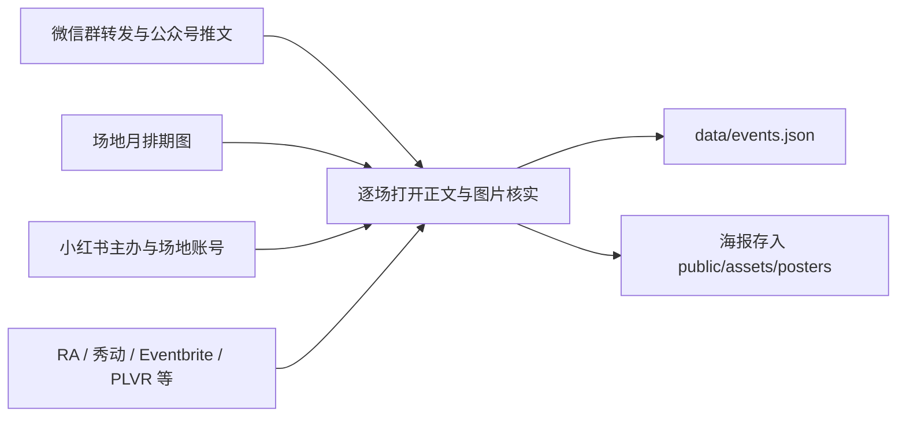
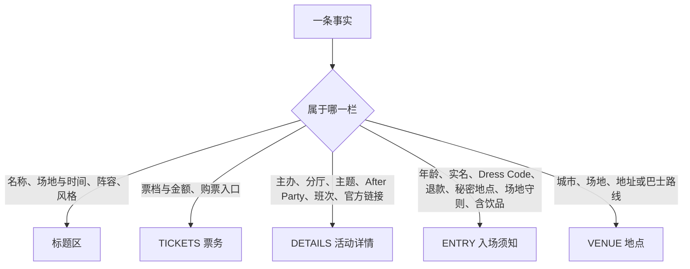

# 活动资讯收集

站点的活动清单（`data/events.json`）从哪里来、按什么范围收集、怎样核实，以及每场的信息怎样分栏。检索与核实的通用规则见 AGENTS.md 第一至四节；原始采集结果、覆盖表与群聊内容留在仓库外的受控目录，不写进本文。

## 现状

### 根本需求

资深 raver 打开站点就能按日期选场、买票：清单只放有正式海报或正式公告、能对应到具体场次的大湾区电子音乐活动，每场的票务、详情、入场须知与地点都能直接用。

### 本期清单

- 2026-10-12 收集 10/12–11/1 发生的活动，写入 74 场（10/14–11/1）：香港 29、深圳 28、广州 15、东莞 2。国庆 57 场已移出，留在 git 历史里。
- 海报 50 张在 `public/assets/posters/`，来源记在 `sources.json`；共用海报（PLAY X 十月全厅排期、OIL 十月总排期等）在首屏只出现一次。
- 主办与场地账号索引 `data/organizer-accounts.json` 共 19 个已核实账号。

### 收录边界（2026-10-12 定）

- 主办在 RA 自己发布的活动页算正式发布，只在 RA 上架的香港场次也收。
- 边界场次收：聆听型电子音乐会（光芒）、社交主题派对（锐舞相亲角）、土潮 DJ 派对（葬爱 vs 土迪）、Pop 歌单夜、尖东免费公共 DJ 演出、锐舞巴士与 TECHNOBUS。香港开放曲风夜不收。
- 商业夜店也收：PLAY X 是一条有四家场地（主厅 LIVE EDM、Le Baron、XLAB、GOLDEN FACE）的娱乐街，同一天的各场地并成一张卡片，每家场地是阵容里的一栏，只有主题、没有艺人的场地（如 GOLDEN FACE 的主题夜）也写在阵容区，不写进活动详情（2026-10-12 moss 指出）；伯乐厅、King's Bar 也收。
- 线索（只有预告摘要、无正式海报或公告）不收。

### 来源

- 场地月排期（OIL、GUM、PLAY X）先看总排期海报，再对单场推文与 RA；三者冲突时以总排期海报与单场推文为准（如 OIL 十月一律 20:00 起）。
- 香港以 RA、Eventbrite、PLVR、vibin 与主办公告为主，阵容以海报为准。

### 每场信息的分栏

- 标题区的时间只写一段（“20:00 起”“15:00–21:00”）；说明行只留影响出行的一条（如改期）。
- 购票方式、活动详情、入场须知的文字每条一行，可带左侧灰色短标签（班次、分厅、主办、卡座、After Party 等）；多项内容一行一项，不写成长句。数据里是文字段的 `label` 与换行。
- 没有来源的字段留空：5 场无地址（3 场秘密地点，入场须知里说明；伯乐厅、EVOKE 主办未公布），PLAY X 没有票价与开场时间。

### 已知缺口

- Club Droowning 十月只确认 10/16，其余场次只有预告摘要；PLAY X 排期图只有日期与艺人。
- 微信群图缺 V2 图片密钥、朋友圈图片加密，读不到；部分图文推文只给壳页。
- AM06 只有群聊说停业，无官方公告，区间内无活动发布。
- 香港没查 Instagram。
- 佛山、珠海、惠州、中山、江门、肇庆在本期区间内没有电子派对发布。
