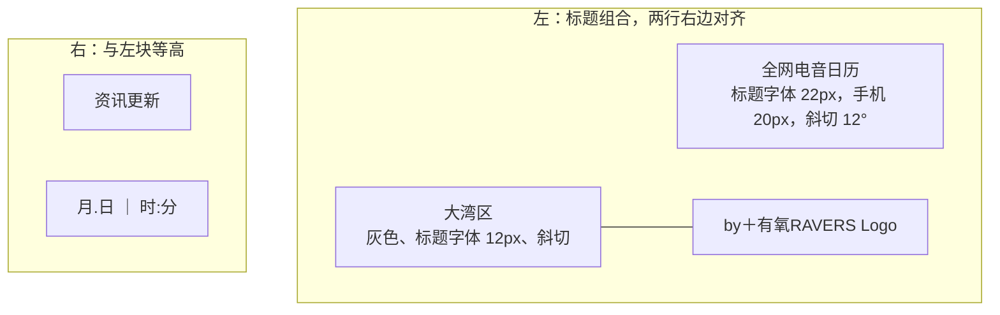

# 站点名称与日期范围

站点叫什么、页眉怎样排站名与署名，以及清单覆盖哪段日期。页眉的字体与对齐细则见 AGENTS.md 项目目标一节。

## 现状

### 根本需求

读者一眼看出这是什么站：定期从全网收集来的大湾区电子音乐活动，按日期选场。站名不绑节日或某段日期，活动范围随收录而变。

### 站名

- 站名“全网电音日历”（2026-10-12 定，由“大湾区电音指南”改来）：moss 要名字表达“定期全网收集”，用直白的说法，不用谐音或意象；地区不必进标题，写在标题下。
- 数据在 `data/events.json` 的 `title`：`name`“全网电音日历”、`region`“大湾区”。页面 `<title>` 与分享卡片标题为“全网电音日历 · 大湾区”（`src/lib/guide.server.ts` 的 `fullTitle`）；搜索与分享简介写“大湾区电音活动日历，全网收录。…”（`src/routes/__root.tsx`）。
- 弃用的方向：“集合”（站点不组织碰头）、“周报”“速递”（暗示固定周期，而收录范围常跨几周）、“合集”（易被读成歌单）。

### 页眉

- 标题字体是自托管的 Noto Sans SC Black 子集，只含“全网电音日历大湾区”九个字（`public/assets/fonts/noto-sans-sc-title-900.woff2`，取自 Google Fonts 按字取子集）；站名再改时要重取子集。
- 页眉检查在 `test/browser/layout.js`：标题文字、两行右边对齐、与更新块不重叠且等高。

### 日期范围

- 不固定节日或起止日期（2026-10-10 定）：清单取所有活动里最早到最晚的日期，每天一组，范围内没有活动的日子显示“当日暂无活动信息”；筛选日历只能选这段日期；页脚写年份与“月.日 — 月.日”。
- 数据里没有 `start_date`、`end_date`；增删活动后范围随之变化（`src/lib/guide.server.ts` 的 `guideDays`）。范围跨年时页脚只写起始年份。
